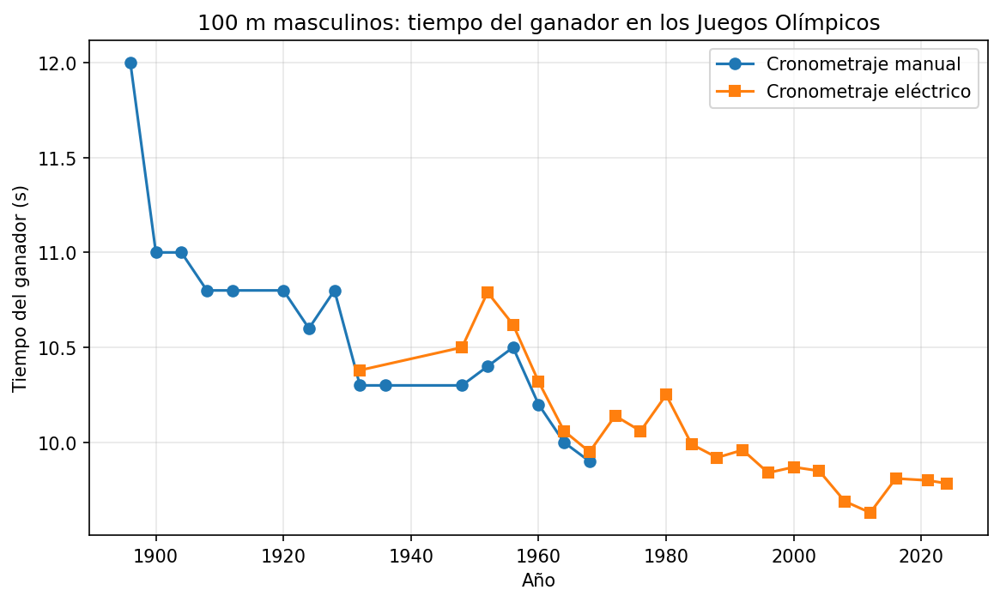
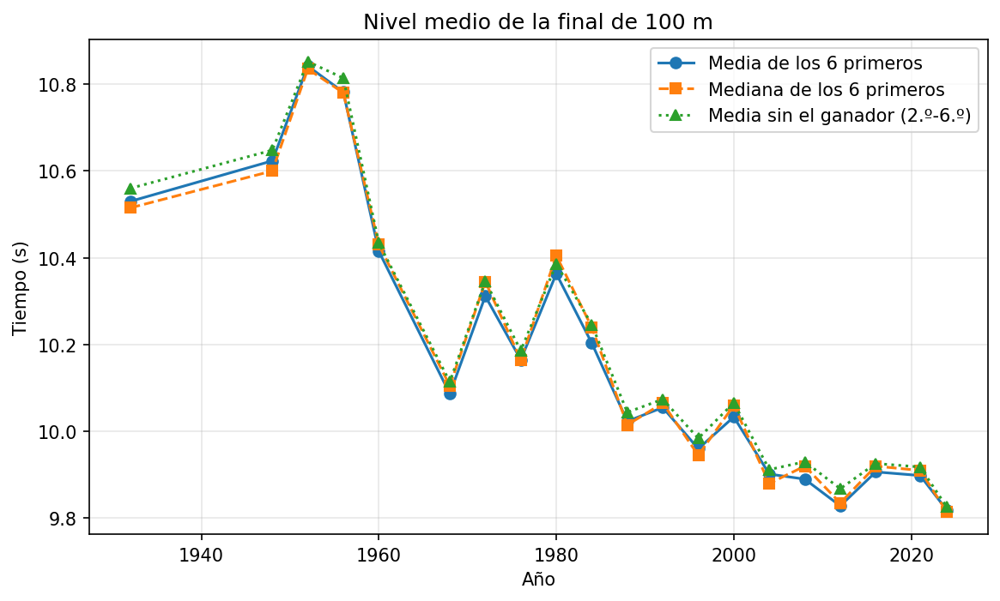

# ¿Ha subido el nivel del 100 m olímpico con el paso de los años?

Análisis de las finales masculinas de 100 m lisos en los Juegos Olímpicos (1896-2024).





*Segunda figura: nivel medio de la final, con tres medidas que dan resultados casi idénticos.*

## Resumen

- El tiempo del ganador pasó de 12.0 s en 1896 a 9.78 s en 2024.
- La mejora afecta a toda la final: la media del 2.º al 6.º clasificado pasó de [X] s en [1932 o 1960] a [9.82] s en 2024.
- El último finalista de 2024 (9.91 s) habría ganado el oro en 22 de las 29 ediciones anteriores.
- Desde 1996 los tiempos apenas varían, salvo en 2008 y 2012 (Usain Bolt).
- El cronometraje manual daba tiempos entre 0.05 y 0.18 s más rápidos que el eléctrico.
- No se puede estimar un límite físico: el ajuste da una asíntota de 8.1 ± 4.2 s, una incertidumbre del tamaño del propio valor.

## Datos

Fuente: [Olympedia](https://www.olympedia.org). Descargado el 28/10/2026.

## Limitaciones

- Conviven cronometraje manual y eléctrico hasta 1968, y 1952 muestra una diferencia anómala (0.41 s).
- No se incluyen datos de viento ni altitud.
- Son solo 30 ediciones y 6 corredores por final: una muestra pequeña.
- Solo pruebas masculinas; el boicot de 1980 pudo debilitar el nivel de esa final.

## Informe

Análisis detallado, con metodología y posibles explicaciones, en el [informe completo (PDF)](report/informe.pdf).

## Cómo reproducirlo

```bash
pip install -r requirements.txt
python src/01_download_100m.py   # opcional: el CSV ya está en data/processed/
python src/02_analisis_100m.py
```

## Autor

[Martín Iglesias] · [martiniglesiaass@gmail.com]